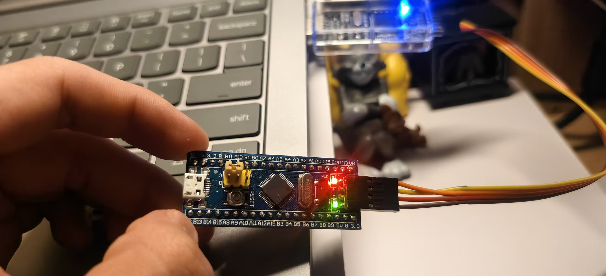
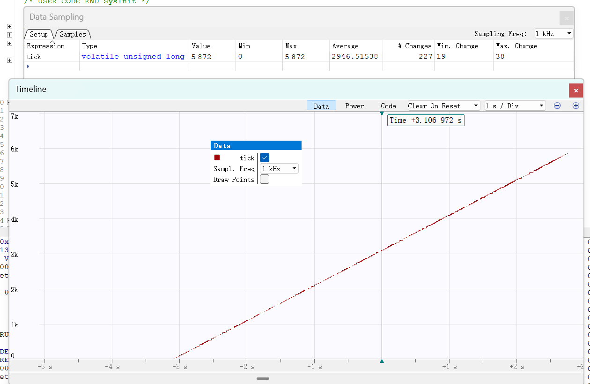
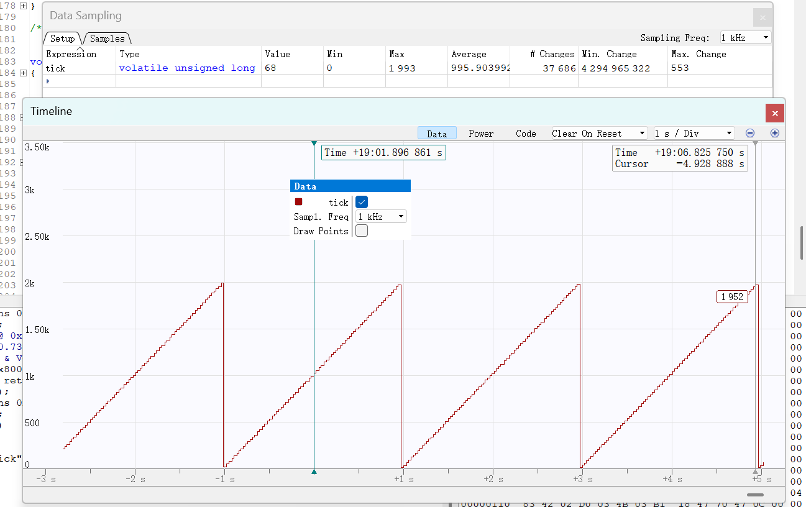

<!--
 * @Author: bowen-0809 bowen-0809@users.noreply.github.com
 * @Date: 2026-10-17 20:06:03
 * @LastEditors: bowen-0809 bowen-0809@users.noreply.github.com
 * @LastEditTime: 2026-10-17 20:27:09
 * @FilePath: \hwk1\电控第一次作业_周结.md
 * @Description: 这是默认设置,请设置`customMade`, 打开koroFileHeader查看配置 进行设置: https://github.com/OBKoro1/koro1FileHeader/wiki/%E9%85%8D%E7%BD%AE
-->
# 电控第一次周结

> **总结**：完成基本焊接的学习并熟练掌握焊接技巧，同时完成第一次作业：基于 STM32F103C6T6A 最小系统板，完成 GPIO 点灯、TIM2 定时中断和 IWDG 独立看门狗三道题的配置、编码、编译与实物验证，工程可 clean build，测试照片和视频已归档。

## 一、本周主要工作

本周学习焊接相关技巧，并围绕电控第一次作业，完成了从外设配置、工程搭建、业务代码编写到实物验证和资料归档的完整流程。三道题共用同一套工程：

- **第 1 题（GPIO）**：将 PC13 配置为推挽输出并输出低电平，点亮板载 LED；
- **第 2 题（定时器 + 喂狗）**：TIM2 产生 1 ms 更新中断，在中断回调中累加 `tick` 并刷新 IWDG，使系统持续运行；
- **第 3 题（看门狗）**：停止喂狗，利用 IWDG 约 2 s 超时特性观察 `tick` 归零和系统复位。

目前工程已通过从零开始的完整编译，三道题均完成实物/调试器验证，相关照片和视频存放在 `hwk1/image/` 目录。

### 任务完成情况

| 题目 | 主要内容 | 关键配置 | 完成状态 |
| --- | --- | --- | --- |
| 第 1 题 GPIO | PC13 输出低电平，点亮板载 LED | PC13 = GPIO_Output，推挽、低速、初始电平 Low | 已完成 |
| 第 2 题 定时器 + 喂狗 | TIM2 每 1 ms 进入更新中断，`tick++` 并刷新 IWDG | PSC = 71，ARR = 999，计数时钟 72 MHz | 已完成（需打开 `KEEP_DOG_FEED`） |
| 第 3 题 看门狗 | 不喂狗，约 2 s 后 IWDG 复位，`tick` 归零 | LSI / 64，Reload = 1249 | 已完成（当前默认配置） |

三题通过 `tasks.c` 中的 `KEEP_DOG_FEED` 宏切换，避免为每道题单独维护一套工程：

### 验证结果

**第 1 题：PC13 板载 LED 点亮**

**第 2 题：喂狗后 `tick` 持续增长**

**第 3 题：不喂狗后 `tick` 周期性归零**

演示视频：

- [第 2 题演示视频](hwk1/image/task2.mp4)
- [第 3 题演示视频](hwk1/image/task3.mp4)

## 二、遇到的问题与处理

这次主要问题在于我没有及时沟通，开发板的型号未确认就直接开始调试，通过ai辅助对比验证C8T6和C6T6这两款开发板的差异才解决

## 三、下周工作计划

完成第一次考核内容的代码编写及调试

## 四、其他感想

暂无
